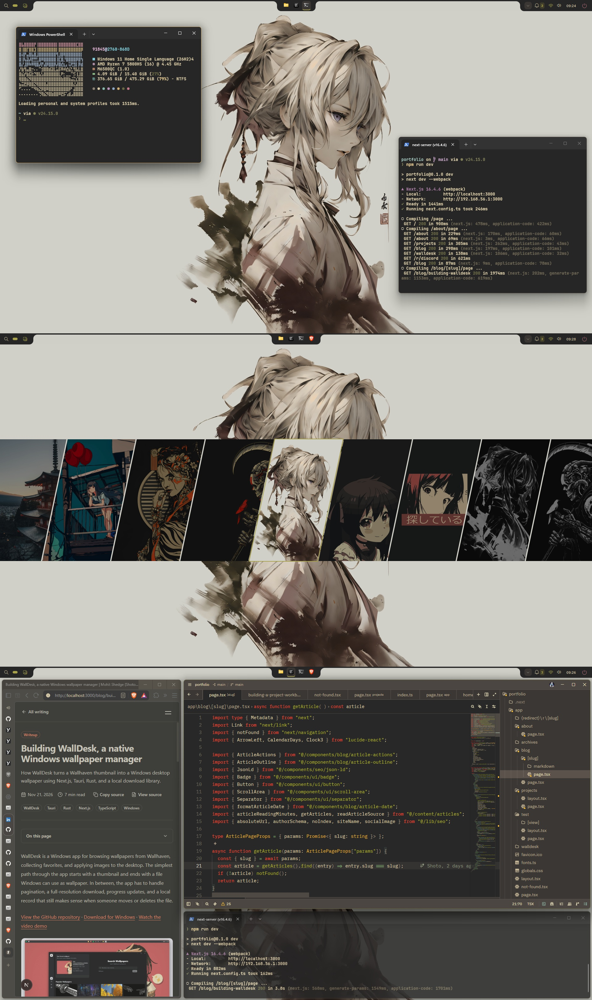

# dotfiles

My Windows rice with Warm Charcoal across the desktop, an adaptive YASB bar, and a compact editor and terminal setup. Komorebi and WHKD handle the optional tiling setup.

## Screenshots



## The setup

| Tool                                           | What’s in the repo                                                                   |
| ---------------------------------------------- | ------------------------------------------------------------------------------------ |
| [YASB](yasb/)                                  | Adaptive islands, app previews, launcher, wallpaper picker, tray, and quick controls |
| [Komorebi + WHKD](komorebi/)                   | Tiling rules, app definitions, and keyboard shortcuts                                |
| [Windows Terminal](terminal/windows-terminal/) | Warm Charcoal ANSI palette and profile defaults                                      |
| [WezTerm](terminal/wezterm/)                   | Pane shortcuts, tabs, and appearance                                                 |
| [Zed](editors/zed/)                            | Editor preferences                                                                   |
| [PowerShell](shell/powershell/)                | Profiles for PowerShell and Windows PowerShell                                       |
| [Fastfetch](shell/fastfetch/)                  | Startup overview and ASCII logo                                                      |
| [Brave](brave/)                                | Warm Charcoal theme manifest                                                         |
| [Windows theme](theme/)                        | Dark mode, olive accent, and reusable CSS color tokens                               |

## Warm Charcoal

| Background | Surface | Hover   | Border  | Text    | Muted   | Accent  | Destructive |
| ---------- | ------- | ------- | ------- | ------- | ------- | ------- | ----------- |
| #262626    | #393633 | #49433B | #49423A | #D8C9A5 | #AAA08C | #A8A34B | #C47788     |

Copy the [CSS palette](theme/palette.css) to use the same colors in another app.

## Keys

| Input                        | Action                               |
| ---------------------------- | ------------------------------------ |
| Alt + Space                  | Open Quick Launch                    |
| Alt + W                      | Cycle windows. Release Alt to switch |
| Alt + E                      | Open the wallpaper gallery           |
| Left-click the bell          | Open the YASB notification panel     |
| Right-click the bell         | Open Windows Notification Center     |
| Left-click the network icon  | Open Windows Quick Settings          |
| Right-click the network icon | Toggle connection details            |
| Click the power icon         | Open the power dropdown              |

## On a new machine

Back up your current configs, install the apps you want, and copy over the matching files. In copied configs, replace `__HOME__` with your Windows home path using forward slashes, such as `C:/Users/your-name`.

| Config           | Where it goes                                                                                              |
| ---------------- | ---------------------------------------------------------------------------------------------------------- |
| YASB             | `%USERPROFILE%/.config/yasb/`                                                                              |
| Windows Terminal | Open the JSON settings file from Windows Terminal                                                          |
| WezTerm          | `%USERPROFILE%/.wezterm.lua`                                                                               |
| Zed              | `%APPDATA%/Zed/settings.json`                                                                              |
| PowerShell       | The matching `PowerShell` or `WindowsPowerShell` folder under Documents                                    |
| Fastfetch        | `%USERPROFILE%/.config/fastfetch/`                                                                         |
| Komorebi         | Put the three JSON files in your home folder, and put `whkdrc` in `%USERPROFILE%/.config/` if you use WHKD |

Keep `network-status.ps1` beside YASB’s `config.yaml` and point the wallpaper picker at your image folder. Pick a local image for `__WALLPAPER__` before applying the Windows theme. The PowerShell profiles expect Starship, and the Windows PowerShell startup banner shows Fastfetch when it’s installed.

To load the Brave theme, close Brave and run this from the repo root.

```powershell
& "$env:ProgramFiles/BraveSoftware/Brave-Browser/Application/brave.exe" "--load-extension=$((Resolve-Path ./brave).Path)"
```

Keep the Brave theme directory in place while it’s active. Git ignores the theme pack Brave generates.

